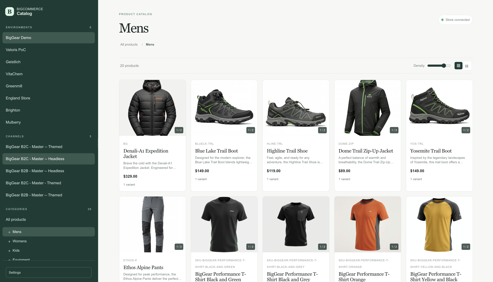

# BigCommerce Catalog Browser

A local, read-only browser for BigCommerce product catalogs. Connect one or more stores, switch between their channels and categories, and inspect product data without navigating the BigCommerce control panel.



## Features

- Manage multiple BigCommerce environments and drag to set their display order.
- Browse channel-specific category trees and product listings.
- Switch between grid and list views, adjust grid density, and load additional products as you scroll.
- View product descriptions, pricing, variants, images, custom fields, categories, related products, and unstructured API data.
- Open a product in the BigCommerce control panel or refresh its details from the API.
- Persist the selected environment, channel, category, layout, and panel sizes locally.
- Encrypt stored access tokens with AES-256-GCM.

## Requirements

- Node.js 20 or later
- npm
- A BigCommerce store hash and API access token with permission to read catalog products, categories, and channels

## Quick Start

1. Install dependencies:

   ```bash
   npm install
   ```

2. Create a `.env.local` file and add a base64-encoded, 32-byte encryption key:

   ```dotenv
   ENVIRONMENTS_ENCRYPTION_KEY=replace-with-a-base64-encoded-32-byte-key
   ```

   Generate a suitable key with:

   ```bash
   openssl rand -base64 32
   ```

3. Start the development server:

   ```bash
   npm run dev
   ```

4. Open [http://localhost:3000](http://localhost:3000), select **Open settings**, and add a store name, store hash, and BigCommerce access token.

The key must remain stable while using the same database. Changing it makes existing encrypted tokens unreadable.

## Configuration

### Required environment variable

| Variable | Description |
| --- | --- |
| `ENVIRONMENTS_ENCRYPTION_KEY` | A base64-encoded key that decodes to exactly 32 bytes. It encrypts access tokens before they are written to SQLite. |

### Optional legacy environment variables

| Variable | Description |
| --- | --- |
| `BIGCOMMERCE_STOREHASH` | Store hash used to create a first environment automatically when the database has no environments. |
| `BIGCOMMERCE_ACCESS_TOKEN` | Access token stored for that automatically created environment. |

For new installations, use the Settings interface instead of the legacy variables. Do not expose either BigCommerce access tokens or the encryption key to the browser, commit them to source control, or share the database with untrusted users.

## Usage

### Environments

Open **Settings** to add, edit, remove, or reorder environments. An environment contains a display name, store hash, and access token. Updating an environment without entering a token preserves its current token.

### Catalog navigation

Select an environment from the sidebar, then choose a channel and category. The browser fetches products from the corresponding BigCommerce catalog. Product pages are retrieved in batches and more products load automatically near the bottom of the page.

Click a product to open its detail panel. Its images can be opened in a zoom viewer; use the left and right arrow keys to change images and Escape to close the viewer or panel.

### Stored preferences

The application saves layout choice, grid density, sidebar width, and detail-panel width for the local application. The selected channel and category are saved separately for each environment.

## Commands

| Command | Description |
| --- | --- |
| `npm run dev` | Start the development server. |
| `npm run build` | Build the production application. |
| `npm run start` | Start the production server after a successful build. |
| `npm run lint` | Run ESLint. |

## Data and Security

Runtime data is stored in `data/catalog.db`, which is intentionally ignored by Git. SQLite write-ahead-log sidecar files may also be present while the application runs.

The database stores environment names, store hashes, encrypted access tokens, ordering, and interface preferences. Tokens are encrypted on the server with AES-256-GCM; the encryption key is not stored in the database. This application is intended for trusted, local or otherwise access-controlled deployments. It does not provide authentication or multi-user access controls.

Back up both `data/catalog.db` and the encryption key together. Restoring only the database without the original key will not restore access to encrypted credentials.

## Architecture

```text
src/app/page.tsx                   Application entry point
src/components/catalog-browser.tsx Catalog browser interface
src/components/environment-settings.tsx
                                  Environment management interface
src/app/api/catalog/route.ts       BigCommerce catalog proxy
src/app/api/environments/route.ts  Environment CRUD and ordering
src/app/api/preferences/route.ts   Local UI preferences
src/lib/bigcommerce.ts             BigCommerce API client
src/lib/environments.ts            SQLite storage and token encryption
data/catalog.db                    Local runtime database
```

BigCommerce API responses for ordinary catalog requests are revalidated every 60 seconds. Refreshing an individual product and fetching related products bypasses that cache.

## HTTP API

The browser uses these same-origin routes internally. They are not authenticated and should only be exposed behind an appropriate trusted-access boundary.

| Route | Methods | Purpose |
| --- | --- | --- |
| `/api/catalog` | `GET` | List catalog products, fetch one product, or fetch related products. Supports `environmentId`, `channelId`, `categoryId`, `page`, `limit`, `productId`, and `relatedProductIds`. `limit` is capped at 250. |
| `/api/environments` | `GET`, `POST`, `PATCH`, `DELETE`, `PUT` | List, create, update, remove, and reorder environments. `PATCH` and `DELETE` require an `id` query parameter; `PUT` accepts an ordered `ids` array. |
| `/api/preferences` | `GET`, `PATCH` | Read and update locally persisted interface preferences. `GET` optionally accepts `environmentId`. |

## Production Deployment

Build and start the application with:

```bash
npm run build
npm run start
```

Use persistent storage for the `data/` directory and configure `ENVIRONMENTS_ENCRYPTION_KEY` as a deployment secret. A serverless or ephemeral filesystem will not retain configured environments and preferences between instances or restarts unless the database is mounted on persistent shared storage. Restrict access to the application because its API routes can retrieve catalog data and manage stored environment credentials.
