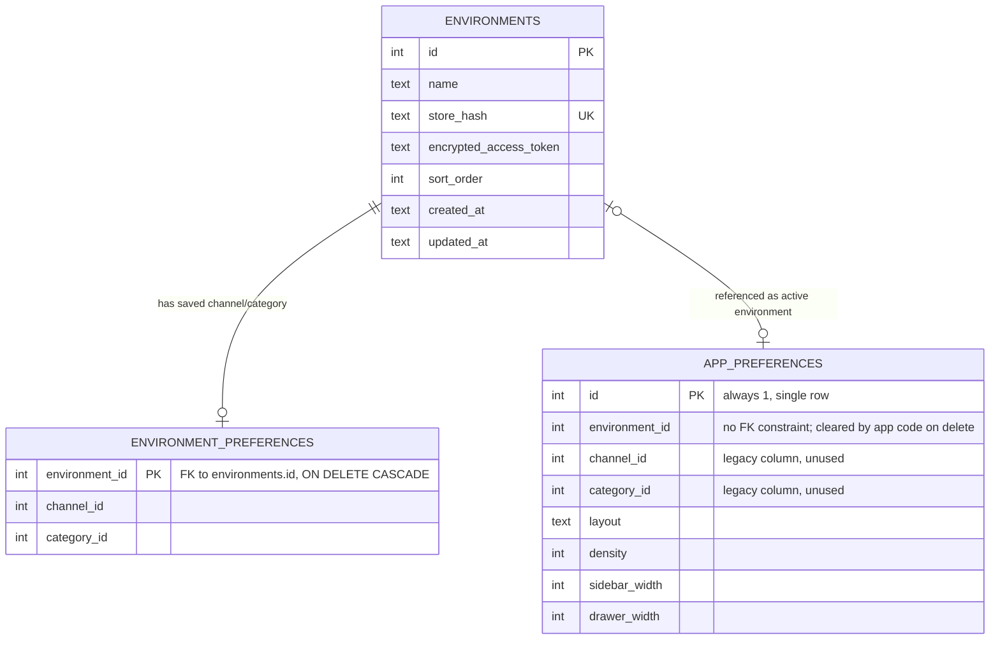

# BigCommerce Catalog Browser

A local, read-only browser for BigCommerce product catalogs. Connect one or more stores, switch between their channels and categories, and inspect product data without navigating the BigCommerce control panel.


## Features

- Manage multiple BigCommerce environments: add, edit, remove (with confirmation), and drag to reorder with directional drop indicators.
- Browse channel-specific category trees, with collapsible category nodes and clickable breadcrumbs for the selected path.
- Switch between grid and list views, adjust grid density, and load additional products as you scroll.
- Navigate the catalog and product images entirely from the keyboard — see [Keyboard Shortcuts](#keyboard-shortcuts).
- Hover a product card to scrub through its images; click a detail-panel image to open a zoom viewer with click-to-zoom, pan, and prev/next controls.
- View product descriptions (rendered HTML), pricing (sale vs. list price), variants, images, custom fields, categories, related products, and collapsible raw API data per field.
- Open a product in the BigCommerce control panel or refresh its details from the API, with a loading indicator while it refetches.
- Resize the sidebar and detail panel by dragging their handles.
- See distinct empty, error, and loading states, plus a connection status indicator for the active environment.
- Persist the selected environment, channel, category, layout, and panel sizes locally.
- Reflect the selected environment, channel, category, and open product in the URL so a specific view can be bookmarked or shared.
- Encrypt stored access tokens with AES-256-GCM.

## Requirements

- Node.js 20 or later
- npm
- A BigCommerce store hash and API access token with permission to read catalog products, categories, and channels

## Quick Start

1. Install dependencies:

   ```bash
   npm install
   ```

2. Create a `.env.local` file and add a base64-encoded, 32-byte encryption key:

   ```dotenv
   ENVIRONMENTS_ENCRYPTION_KEY=replace-with-a-base64-encoded-32-byte-key
   ```

   Generate a suitable key with:

   ```bash
   openssl rand -base64 32
   ```

3. Start the development server:

   ```bash
   npm run dev
   ```

4. Open [http://localhost:3000](http://localhost:3000), select **Open settings**, and add a store name, store hash, and BigCommerce access token.

The key must remain stable while using the same database. Changing it makes existing encrypted tokens unreadable.

## Configuration

### Required environment variable

| Variable | Description |
| --- | --- |
| `ENVIRONMENTS_ENCRYPTION_KEY` | A base64-encoded key that decodes to exactly 32 bytes. It encrypts access tokens before they are written to SQLite. |

### Optional legacy environment variables

| Variable | Description |
| --- | --- |
| `BIGCOMMERCE_STOREHASH` | Store hash used to create a first environment automatically when the database has no environments. |
| `BIGCOMMERCE_ACCESS_TOKEN` | Access token stored for that automatically created environment. |

For new installations, use the Settings interface instead of the legacy variables. Do not expose either BigCommerce access tokens or the encryption key to the browser, commit them to source control, or share the database with untrusted users.

## Usage

### Environments

Open **Settings** to add, edit, remove, or reorder environments. An environment contains a display name, store hash, and access token; the store hash must be unique across environments. Updating an environment without entering a token preserves its current encrypted token. Removing an environment asks for confirmation first. Drag a row to reorder it — a drop indicator shows whether it will land before or after the row underneath the pointer; reordering applies immediately and rolls back if saving the new order fails. Press Escape to close the Settings panel.

### Catalog navigation

Select an environment from the sidebar, then choose a channel and category from the collapsible category tree. The breadcrumb in the topbar reflects the selected category path and each segment is clickable. The browser fetches products from the corresponding BigCommerce catalog. Product pages are retrieved in batches and more products load automatically near the bottom of the page. Switching environments reloads that environment's own saved channel and category.

Click a product to open its detail panel, or use the keyboard shortcuts below. Hovering a product card scrubs through its images based on cursor position. Click a detail-panel image to open the zoom viewer, which supports click-to-zoom, panning, and prev/next/close buttons in addition to keyboard controls.

Drag the handles between the sidebar, catalog, and detail panel to resize them.

The URL updates as you navigate to include the selected environment, channel, category, and open product (for example, `?environmentId=1&channelId=2&categoryId=3&productId=4`). Bookmark or share a URL to return directly to that view; opening a URL with these parameters overrides the locally saved preferences for that load.

## Keyboard Shortcuts

Global shortcuts are ignored while a modifier key (Cmd/Ctrl/Alt) is held, while focus is on an input, button, or link, or while the Settings panel is open.

| Keys | Action | Context |
| --- | --- | --- |
| `g` | Switch to grid layout | Global |
| `l` | Switch to list layout | Global |
| `+` / `=` | Increase grid density (up to 6 columns) | Global, grid layout |
| `-` | Decrease grid density (down to 2 columns) | Global, grid layout |
| Arrow keys | Move focus between product cards (grid-aware) and scroll into view | Global, catalog has products |
| `Enter` | Open the focused product's detail panel | Global |
| `Escape` | Clear keyboard-navigation focus | When a product is keyboard-focused |
| `Escape` | Close the product detail panel | Detail panel open |
| `Escape` | Close the Settings panel | Settings open |
| `←` / `→` | Cycle the detail-panel thumbnail image | Detail panel open, zoom viewer closed |
| `Enter` | Open the zoom viewer for the current thumbnail | Detail panel open, zoom viewer closed |
| `←` / `→` | Change image | Zoom viewer open |
| `+` / `=` | Zoom in (up to 4x) | Zoom viewer open |
| `-` | Zoom out (down to 1x) | Zoom viewer open |
| `0` | Reset zoom to 1x | Zoom viewer open |
| `Escape` | Close the zoom viewer | Zoom viewer open |

### Stored preferences

The application saves layout choice, grid density, sidebar width, and detail-panel width for the local application. The selected channel and category are saved separately for each environment.

## Commands

| Command | Description |
| --- | --- |
| `npm run dev` | Start the development server. |
| `npm run build` | Build the production application. |
| `npm run start` | Start the production server after a successful build. |
| `npm run lint` | Run ESLint. |

## Data and Security

Runtime data is stored in `data/catalog.db`, which is intentionally ignored by Git. SQLite write-ahead-log sidecar files may also be present while the application runs.

The database stores environment names, store hashes, encrypted access tokens, ordering, and interface preferences. Tokens are encrypted on the server with AES-256-GCM; the encryption key is not stored in the database. This application is intended for trusted, local or otherwise access-controlled deployments. It does not provide authentication or multi-user access controls.

Back up both `data/catalog.db` and the encryption key together. Restoring only the database without the original key will not restore access to encrypted credentials.

### Database schema



- `environments` holds one row per configured BigCommerce store; `store_hash` is unique and `encrypted_access_token` is AES-256-GCM ciphertext.
- `environment_preferences` stores the last-selected channel and category per environment, keyed by `environment_id` and removed automatically when the environment is deleted (`ON DELETE CASCADE`).
- `app_preferences` is a single-row table (`id` is constrained to `1`) holding application-wide UI state — the active environment and layout/density/panel-width settings. Its `environment_id` column is not an enforced foreign key; `src/lib/environments.ts` clears it manually when the referenced environment is deleted. Its `channel_id`/`category_id` columns predate `environment_preferences` and are no longer written to.

## Architecture

```text
src/app/page.tsx                   Application entry point
src/components/catalog-browser.tsx Catalog browser interface
src/components/environment-settings.tsx
                                  Environment management interface
src/app/api/catalog/route.ts       BigCommerce catalog proxy
src/app/api/environments/route.ts  Environment CRUD and ordering
src/app/api/preferences/route.ts   Local UI preferences
src/lib/bigcommerce.ts             BigCommerce API client
src/lib/environments.ts            SQLite storage and token encryption
data/catalog.db                    Local runtime database
```

BigCommerce API responses for ordinary catalog requests are revalidated every 60 seconds. Refreshing an individual product and fetching related products bypasses that cache.

## HTTP API

The browser uses these same-origin routes internally. They are not authenticated and should only be exposed behind an appropriate trusted-access boundary.

| Route | Methods | Purpose |
| --- | --- | --- |
| `/api/catalog` | `GET` | List catalog products, fetch one product, or fetch related products. Supports `environmentId`, `channelId`, `categoryId`, `page`, `limit`, `productId`, and `relatedProductIds`. `limit` is capped at 250. |
| `/api/environments` | `GET`, `POST`, `PATCH`, `DELETE`, `PUT` | List, create, update, remove, and reorder environments. `PATCH` and `DELETE` require an `id` query parameter; `PUT` accepts an ordered `ids` array. |
| `/api/preferences` | `GET`, `PATCH` | Read and update locally persisted interface preferences. `GET` optionally accepts `environmentId`. |

## Production Deployment

Build and start the application with:

```bash
npm run build
npm run start
```

Use persistent storage for the `data/` directory and configure `ENVIRONMENTS_ENCRYPTION_KEY` as a deployment secret. A serverless or ephemeral filesystem will not retain configured environments and preferences between instances or restarts unless the database is mounted on persistent shared storage. Restrict access to the application because its API routes can retrieve catalog data and manage stored environment credentials.
